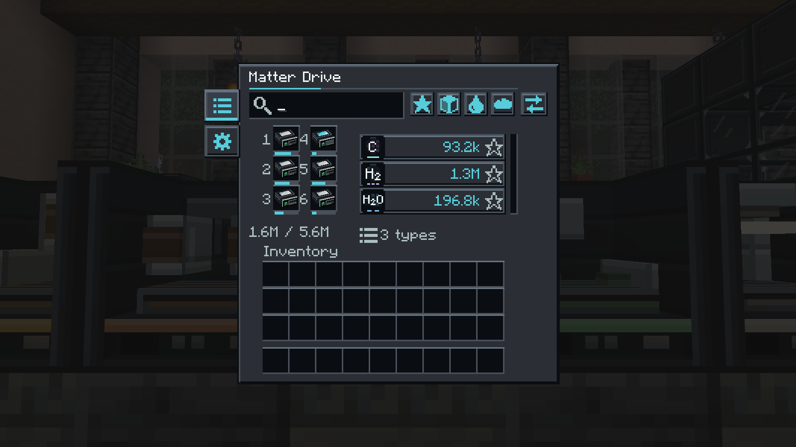

# ReMatter

**ReMatter is an industrial chemistry mod for Minecraft, developed for [LatroX's Xtreme – Tech ReForging](https://www.curseforge.com/minecraft/modpacks/latroxs-xtreme-tech-reforging).** You can also play it on its own. Break down familiar blocks and items, store the substances they contain, and use researched recipes to make materials for your next build.

## From materials to substances and back

1. **Break materials down.** Put a supported block or item into the Decomposer. Its recipe determines which substances you recover and in what quantities. Processing a sample can also teach you its material family.
2. **Keep a shared stock.** A **Matter Cell** records how much of each solid, liquid and gas you have. Insert it into a **Matter Drive** so connected machines can use its contents, or pull it out to carry the whole stock to another base.
3. **Run a reaction when you need one.** Some recovered substances are ready to use. Others need more work. A Chemical Processor can separate a mixture or use electricity to split stored water into hydrogen and oxygen. Both gases stay available for later recipes.
4. **Make something you need.** Pick a researched recipe at the **Material Synthesizer**. It consumes the listed quantities and power, then delivers a product such as a glass block or lava in its tank. Those raw materials feed your existing crafting lines for cables, tools and machines.

## Your first glass

1. **Start by hand.** Crank sand in the Hand Preparator for Silith, then process a clay ball for Argil. Mix them into Matrix Blend, then form your first Matrix Crystals.
2. **Make power.** The basic Crystal Generator uses an Ember Matrix Crystal and two copper blocks for its coils. Fuel it with spare crystals to run the Material Preparator and make the parts for your first production line.
3. **Turn sand into glass.** Install a 64k Matter Cell in a Matter Drive. Feed one sand block to a connected Decomposer to learn the Sand & Glass family and store 1,000 units of silica. Select **Glass** on the Material Synthesizer, confirm with **Use recipe**, then press **Make 1** to spend that silica on one glass block.

Place Silith above a book in the crafting grid to make the **ReMatter Guide**. It includes recipes and machine layouts.

## Scaling up production

To turn spare cobblestone into a steady supply of lava, blend and melt the recovered minerals in a Chemical Processor, then select **Lava** at the Material Synthesizer. A full batch delivers 1,000 mB for a bucket or a fluid pipe. For larger production runs, build a multiblock Chemical Reactor and fit its chamber with field stabilizers and reaction foci.

Pin a goal at the Matter Terminal to see which process to run first, what you still need and which byproducts you’ll have left.

## Play and build

Choose the ReMatter file for your Minecraft and NeoForge versions. For multiplayer, install the same file on the server and on each client. Version 0.7.0 targets Minecraft 26.1.2, NeoForge 26.1.2.126 and Java 25.

To build from source, run `./gradlew build` on macOS or Linux, or `gradlew.bat build` on Windows. The mod JAR is written to `build/libs/`.

[Optional mod integrations](docs/integrations.md) · [Chemistry data packs](docs/data-packs.md) · [Report an issue](https://github.com/LatroX-dev/ReMatter/issues)

Code, data and documentation use [LGPL-3.0-only](COPYING.LESSER). Textures, models, sounds and other artwork are covered by the [asset license](LICENSE-ASSETS.md).

Created by LatroX with AI assistance. Inspired by [Alchemistry](https://www.curseforge.com/minecraft/mc-mods/alchemistry).
