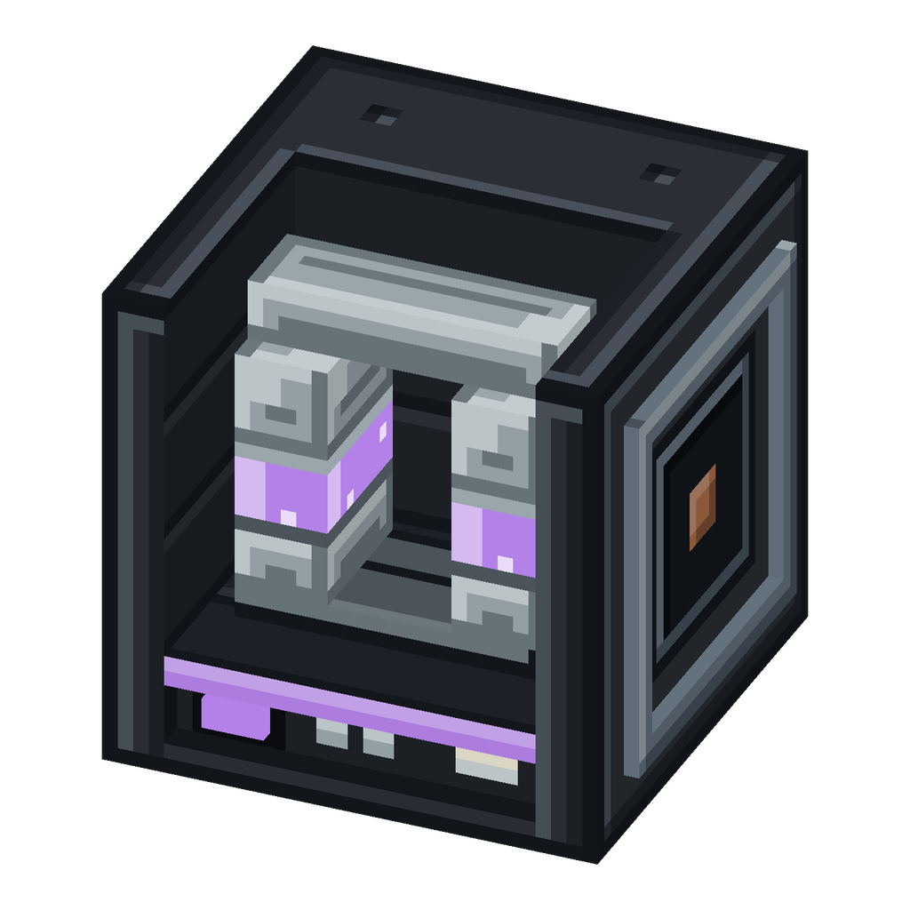
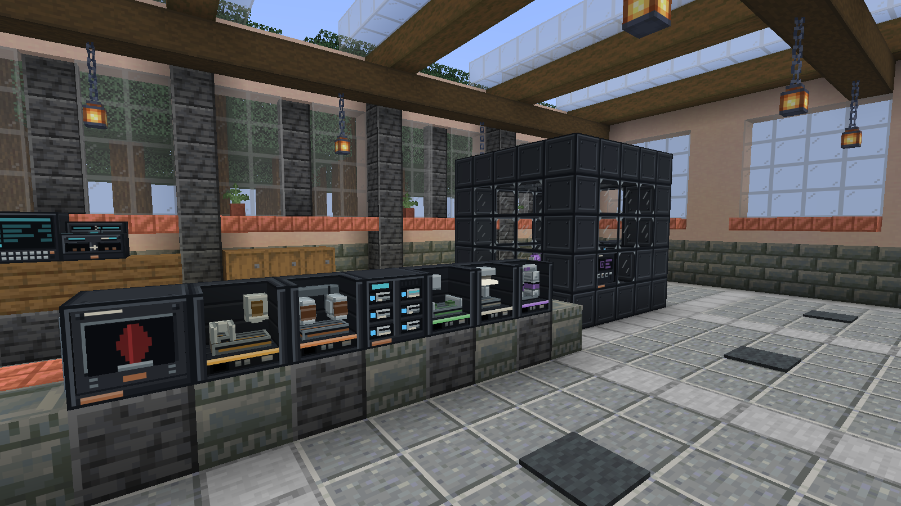
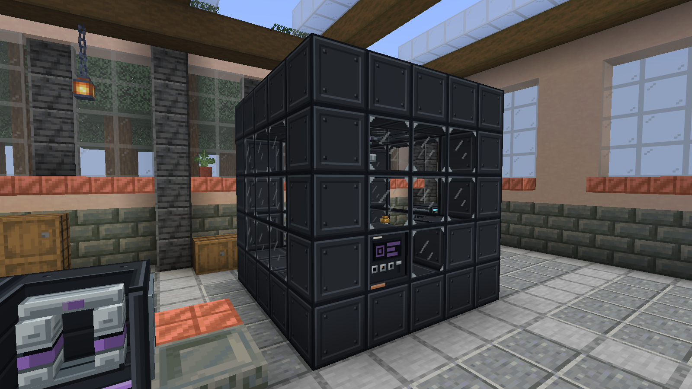

# ReMatter

**An industrial chemistry mod for Minecraft Java Edition 26.1.2 on NeoForge.**

A single Matter Cell can hold silica from sand alongside hydrogen and oxygen from water. Slide the cell into a Matter Drive and your machines can draw on those supplies. Pull it out and carry the contents to another workshop.

## Your first glass

1. **Start by hand.** Crank sand in the Hand Preparator for Silith, then process a clay ball for Argil. Mix them into Matrix Blend, then form your first Matrix Crystals.
2. **Make power.** The basic Crystal Generator uses an Ember Matrix Crystal and two copper blocks for its coils. Fuel it with spare crystals to run the Material Preparator and make the parts for your first production line.
3. **Turn sand into glass.** Install a 64k Matter Cell in a Matter Drive. Feed one sand block to a connected Decomposer to learn the Sand & Glass family and store 1,000 units of silica. Select **Glass** on the Material Synthesizer, confirm with **Use recipe**, then press **Make 1** to spend that silica on one glass block.

Place Silith above a book in the crafting grid to make the **ReMatter Guide**. It includes recipes and machine layouts.

## A larger workshop

Need lava far from the Nether? Decompose cobblestone, blend and melt the recovered minerals in a Chemical Processor, then draw a bucket of lava from the Material Synthesizer. As your factory grows, a Chemical Reactor can run the same reactions in a chamber you build and fit yourself.

Pin a goal at the Matter Terminal to see which process to run first, what you still need and which byproducts you’ll have left. Machines, tools and circuits keep their own crafting recipes.

## Play and build

**ReMatter 0.7.0** uses **Java 25** and **NeoForge 26.1.2.126**. Install the mod on both client and server for multiplayer. The starter workshop runs with ReMatter alone. ReForging 0.11.1 adds its own progression and quests.

To build from source, run `./gradlew build` on macOS or Linux, or `gradlew.bat build` on Windows. The mod JAR is written to `build/libs/`.

[Optional mod integrations](docs/integrations.md) · [Chemistry data packs](docs/data-packs.md) · [Report an issue](https://github.com/LatroX-dev/ReMatter/issues)

Code, data and documentation use [LGPL-3.0-only](COPYING.LESSER). Textures, models, sounds and other artwork are covered by the [asset license](LICENSE-ASSETS.md).

Inspired in part by [Alchemistry](https://www.curseforge.com/minecraft/mc-mods/alchemistry).
