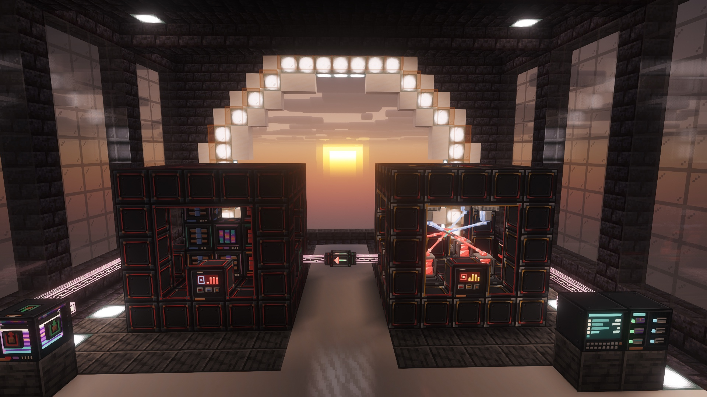
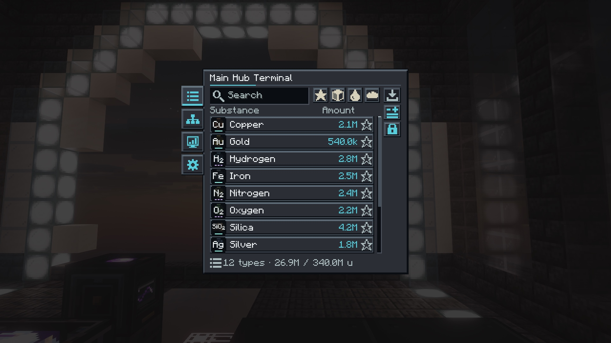
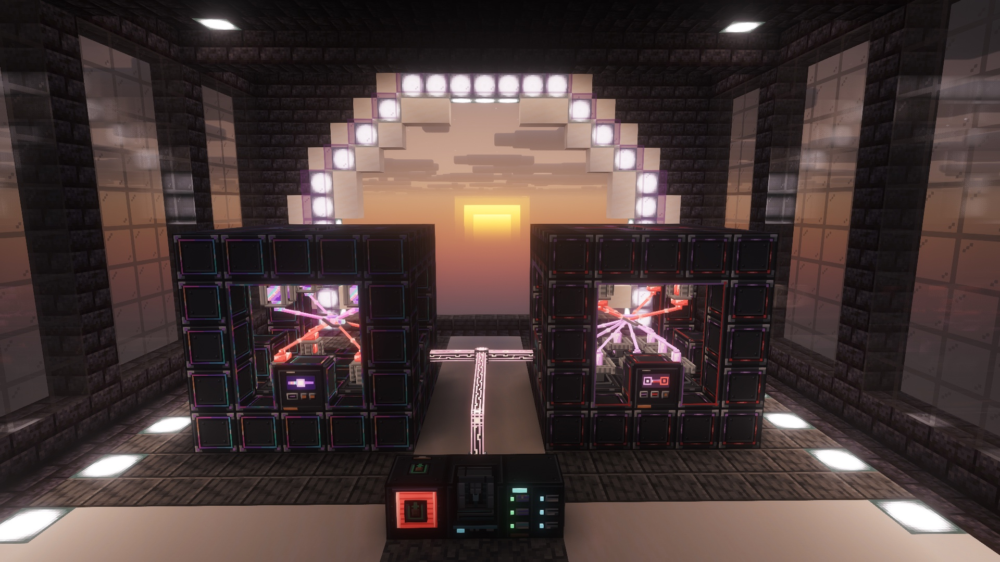
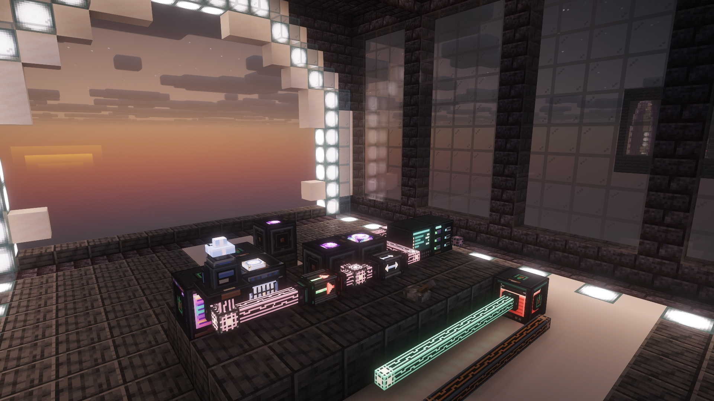
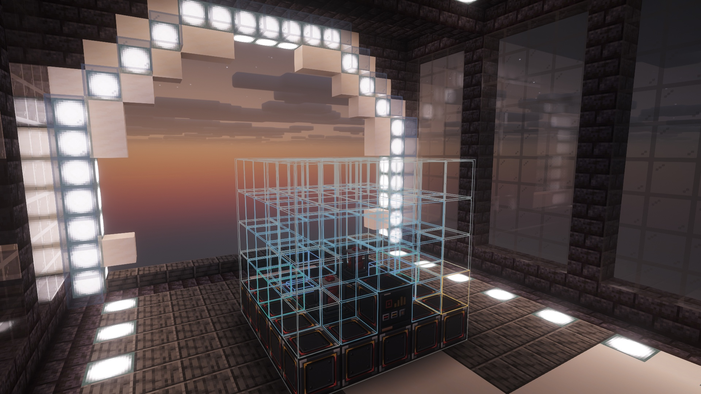

# ReMatter

**ReMatter is an industrial chemistry mod for Minecraft, developed for [LatroX's Xtreme – Tech ReForging](https://www.curseforge.com/minecraft/modpacks/latroxs-xtreme-tech-reforging).** It also runs on its own, with its own power, storage and in-game guide. Break down familiar materials, keep the substances you recover and use them in another recipe. Silica recovered from sand can become glass for your base. Minerals recovered from cobblestone can supply a tank of lava.

## Your first glass

1. **Start by hand.** Crank sand in the Hand Preparator to get Silith, then use a clay ball to get Argil. Mix one of each into four Matrix Blend and form your first Matrix Crystals. Place Silith above a book in the crafting grid to make the **ReMatter Guide**.
2. **Power a small line.** Craft a Crystal Generator with an Ember Matrix Crystal and two blocks of copper. Fuel it with spare crystals, or connect another FE source. Place a Matter Drive between a powered Decomposer and a powered Material Synthesizer and install a 4M Matter Cell in the Drive. Touching machines can share its stock.
3. **Decompose one sand block.** With the default recipes, the Decomposer spends 8,000 FE, stores **1,000 units of solid silica** and teaches you the Sand & Glass family. Open the Drive to see the silica. Leave the cell installed for the next step.
4. **Make one glass block.** On the Material Synthesizer, choose **Glass**, confirm with **Use recipe**, then press **Make 1**. It draws the same 1,000 units from the Drive and spends 16,000 FE to produce one glass block.

For a rare sample you want to keep, use the **Analyzer**. It spends energy to identify the material family and returns the sample. Research unlocks eligible raw materials, including metals, glass and natural blocks. Turn those materials into wires, gears, tools and machines through their usual crafting or processing recipes.

## Storage and production orders

Each Matter Drive holds up to six removable cells. A cell records quantities by substance and phase, so liquid water and water vapor have separate balances. Add **Matter Cables** to reach more machines and carry power from a generator or **Energy Cube**. A **Pressurized Canister** lets you carry a single liquid or gas between installations.

At the **Matter Terminal**, search the stock by name or filter it by phase. Open **Request Batch** to plan a target across connected machines. Pin the goal to see the next step, missing inputs, energy cost and leftover products as you work. For a recurring job, use **Loop** on the machine or set a stock target in its production settings. The Terminal's **Monitor** tab shows whether a substance is accumulating or being used up.

## What to build next

- **Make gas from water.** Use a water bucket on the Decomposer to store 1,000 units of liquid water. One **Water electrolysis** batch in a Chemical Processor converts that stock into 1,000 units of hydrogen and 500 of oxygen. Both gases return to the network.
- **Supply lava from cobblestone.** Decompose the stone, then run **Mineral blending** and **Mineral melting** in a Chemical Processor. Select **Lava** in the Material Synthesizer to deliver 1,000 mB to its tank, ready for a bucket or fluid pipe.
- **Build industrial chambers.** Scale up with the **Industrial Preparator**, **Chemical Reactor**, **Industrial Decomposer**, **Industrial Synthesizer**, **Transmutation Reactor**, **Primal Reactor**, **Energy Reactor**, and **Energy Matrix**. Fit `3×3×4` to `9×9×9` chambers with modular interior hardware, mixed glass/casing shells, interactive 3D blueprint previews, partial-build completion, and one-click Auto-Build. Parallel Upgrades let processing chambers run up to four concurrent batches at once; a formed Industrial Synthesizer provides Tier 2 crystallization pressure built in.
- **Collect atmospheric gases and extract deep cores.** Leave the intake of a powered Atmospheric Collector open to the Overworld sky and select **Air Separation** to collect 200 units of oxygen per batch, or place a **Deep-Core Extractor** over bedrock to drill concentrated mineral filtrates for industrial refining.
- **Explore Primal research and logistics.** Mine Primal Ore and load its shards into a dedicated Primal Cell. At the Analyzer, spend that reserve to derive an eligible material from known substances, or build **Matter Cable Relays** (Redstone gating, channel isolation, one-way diodes, substance filters, and rate limits), **Dimensional Entangled Links**, **Spatial Anchors**, and **Global Network Reserves** to orchestrate multi-dimensional facilities.

## Endgame power, extraction & multi-dimensional logistics

- **Generate and store massive FE.** Ramp up an **Energy Reactor** (`5×5×5` to `9×9×9`, `lightLevel = 12`, Crystal/Matter/Primal fuel modes, Water & Cryogenic Nitrogen coolant overdrive) and pipe its output into a silent 64-bit **Energy Matrix** packed with freely mixable 3D tiers of Cells and Providers.
- **Transmute, condense Primal Matter, and drill deep cores.** Build `5×5×5` to `9×9×9` **Transmutation** and **Primal Reactors** alongside bedrock-probing **Deep-Core Extractors**, guided by an interactive **3D Blueprint Hologram**, partial-build completion, mixed Connected Glass/Casing shells, and claim-compatible Auto-Build.
- **Orchestrate factory networks.** Drop inline **Matter Cable Relays** (Redstone gating, channel isolation, animated One-Way Diodes, substance filters, and shared `FE/t` / `Matter/t` caps), bridge dimensions with **Dimensional Entangled Links**, load chunks natively with **Spatial Anchors** (clickable `5×5` chunk map) and **Anchor Upgrades**, and protect key stocks with **Global Network Reserves**.

## Optional integrations

| What you want to do | Mods and setup |
| --- | --- |
| Order chemistry from your storage grid | Connect a ReMatter **Network Interface** to [Applied Energistics 2](https://www.curseforge.com/minecraft/mc-mods/applied-energistics-2) or [Refined Storage](https://www.curseforge.com/minecraft/mc-mods/refined-storage). Select your storage system in the interface settings, enable **Automation**, then enable **Network jobs** on the machines that should accept orders. |
| Look up a recipe | [Just Enough Items](https://www.curseforge.com/minecraft/mc-mods/jei) (including JEI++) and [SEMI (Seasonal EMI)](https://www.curseforge.com/minecraft/mc-mods/semi-seasonal-emi) show exact batch inputs, yields, base energy with `FE/t` rates, durations in seconds and ticks, unified cross-mod outputs, and live substance hover/recipe lookups across all ReMatter screens. |
| Read machines and layouts in-game | [Jade](https://www.curseforge.com/minecraft/mc-mods/jade) shows live `FE/t` draw, machine status, Energy Cubes, Wireless Access Points, Level Emitters, Matter Cable Relays, Spatial Anchors, Entangled & Dimensional Links, and Cell Transfer Stations. [GuideME](https://www.curseforge.com/minecraft/mc-mods/guideme) adds interactive 3D layouts to the ReMatter Guide. |
| Wear portable gear & use hotkeys | With [Curios](https://www.curseforge.com/minecraft/mc-mods/curios), equip the **Wireless Matter Terminal** (`charm`), **Portable Energy Cell** (`belt`), and **Spectrometer Lens** or **Discovery Lens** (`head`/`charm`). Bind **Open Wireless Matter Terminal** and **Toggle Spectrometer Lens** in Controls to use your terminal or toggle the live spectrometer HUD and Shift composition tooltips without switching hotbar slots. |
| Supply a chemical line | With [Mekanism: Version Locked](https://www.curseforge.com/minecraft/mc-mods/mekanism-version-locked), enable **Automation** on the Matter Drive and connect a Pressurized Tube to move supported chemicals such as hydrogen, oxygen, chlorine, brine and sodium. |
| Process ReMatter alloys and dusts | Optional recipes support [Oritech](https://www.curseforge.com/minecraft/mc-mods/oritech), [Ender IO](https://www.curseforge.com/minecraft/mc-mods/ender-io), [FTB Industrial Contraptions](https://www.curseforge.com/minecraft/mc-mods/ftb-industrial-contraptions-forge), [Energized Power](https://www.curseforge.com/minecraft/mc-mods/energized-power) and Mekanism machines for alloy smelting and dust grinding. |
| Run a shared or private facility | Every device and cable supports **Public** *(default)*, **Trusted** and **Private** security modes via the device screen, the **Security Card** (single block or Sneak + Right-Click network sweep), `/rematter trust`, `/rematter security default`, and optional [FTB Teams](https://www.curseforge.com/minecraft/mc-mods/ftb-teams-forge). |

See the [integration guide](docs/integrations.md) for supported API versions and details on connecting external storage and chemical networks.

## Install, build and get help

ReMatter 0.50.x targets **Minecraft 26.1.2, NeoForge 26.1.2.126 and Java 25**. For multiplayer, put the same ReMatter JAR in the server's and each client's `mods` folder.

To build from source, run `./gradlew build` on macOS or Linux, or `gradlew.bat build` on Windows. The JAR is written to `build/libs/`. Pack authors can define new material profiles, permitted synthesis outputs and processes with [chemistry data packs](docs/data-packs.md).

[Read the ReMatter Wiki](https://github.com/LatroX-dev/ReMatter/wiki) for illustrated recipes, reactor layouts and troubleshooting.

[Report a bug, request a material or suggest a feature](https://github.com/LatroX-dev/ReMatter/issues/new/choose). For a recipe issue, include the item or fluid ID, your ReMatter version and the result you expected.

Code, data and documentation use [LGPL-3.0-only](COPYING.LESSER). Textures, models, sounds and other artwork are covered by the [asset license](LICENSE-ASSETS.md).

Inspired by [Alchemistry](https://www.curseforge.com/minecraft/mc-mods/alchemistry).

I build ReMatter from my own ideas and development experience, with AI as one of the tools I use along the way. I want the mod to be fun to play, and your feedback helps me decide what to improve next.

— LatroX
